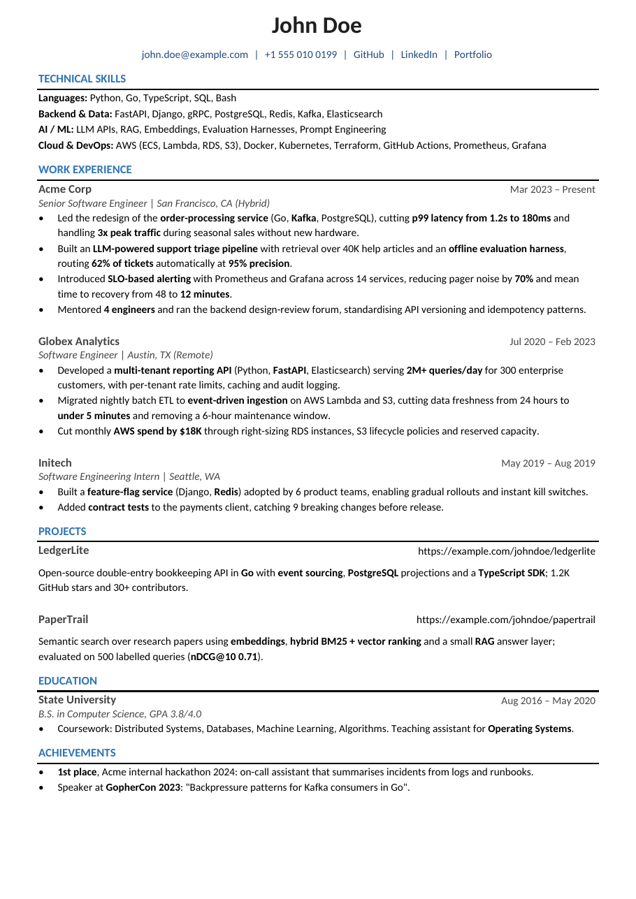

# Resume template

A one-page resume template (recreated from a Word/Calibri resume) built from
structured data and a [Typst](https://typst.app) template. A person edits it in
a form UI with a live preview; an AI agent edits the same JSON through a CLI or
an MCP server. Both produce the same PDF in the same format.

[](examples/John_Doe_Resume.pdf)

<sub>The fictional sample above is generated from [`data/sample.json`](data/sample.json); the PDF is [`examples/John_Doe_Resume.pdf`](examples/John_Doe_Resume.pdf).</sub>

```
data/base.json ─┐                     ┌─ web UI (browser, WASM)  → preview + Download PDF
data/variants/* ├─► template/resume.typ ┤
                │   (same compiler)    └─ CLI / MCP (Node)       → out/<name>.pdf + lint
```

## Setup

```bash
npm install
```

No TeX or Typst install is needed: the Typst compiler ships as npm packages (typst.ts 0.7.0).

Your own resume lives in `data/base.json`, which is **git-ignored** (so are `data/variants/` and `out/`), so personal details never end up in the repo. On a fresh clone, the first command copies the John Doe sample to `data/base.json` for you to overwrite. Edit it in the UI, or ask an agent to fill it in from your existing resume.

## For people: the editor

```bash
npm run dev          # http://localhost:5173
```

- **Form tab:** edit the header, skills, experience, education, projects and custom sections. Drag ⠿ to reorder, use ● / ◌ to hide or show an item (it stays in the file), and **B** or ⌘B to bold the selected text (stored as `**bold**`).
- **JSON tab:** the raw document, validated as you type.
- **Live preview:** compiled in the browser with the same template. The badge shows the page count, the free lines left and the layout warnings; click it to see each warning and jump to its field.
- **Variant picker and + Variant:** switch between `base`, the `sample` and the tailored copies in `data/variants/`, or make a new copy.
- Edits save to `data/*.json` automatically, and changes an agent makes on disk show up live.
- Use `?r=<variant>` in the URL to open a variant directly.

### Deploying the editor

```bash
npm run build        # static site in dist/
npm run preview      # check it locally
```

The deployed site has no file API. It opens on the John Doe sample (`data/sample.json`), saves each visitor's edits to their browser's localStorage, and offers Import/Export JSON (bring your own resume) and Reset. Your `data/base.json` is never bundled. `vercel.json` is set up for a static Vercel deploy.

## For agents

See **[AGENTS.md](AGENTS.md)**: data model, truthfulness rules, writing style, how to fit the page, and the tailoring workflow. Claude Code loads it through `CLAUDE.md`, and the skill in `.claude/skills/tailor-resume/` triggers on job descriptions and resume-edit requests.

```bash
npm run resume -- new-variant acme-backend      # copy base → data/variants/acme-backend.json
npm run resume -- lint acme-backend             # one page? orphan lines? long bullets?
npm run resume -- build acme-backend            # → out/acme-backend.pdf
npm run resume -- diff base acme-backend        # what changed
npm run resume -- help                          # all commands; add --json for machine output
```

The MCP server is registered in `.mcp.json`, so Claude Code picks it up in this folder. For other clients, run `npx tsx src/mcp/server.ts` from the repo root over stdio. Its tools are `list_resumes`, `read_resume`, `create_variant`, `apply_resume_patch`, `update_resume`, `lint_resume`, `render_pdf` and `diff_resumes`, plus the prompt `tailor_to_jd`.

Example prompts: *"Tailor my resume to this JD: …"*, *"Add a bullet about X to my WhatBytes role and regenerate the PDF"*, *"Make a version for Stripe's backend role and keep it to one page"*.

## Layout

| Path | |
|---|---|
| `template/resume.typ` | The layout. Defaults were measured from the original PDF's content stream: A4, 36pt side margins, Calibri metrics, name 22pt `#1F1F1F`, contact `#1F497D`, section titles 11pt bold `#2E74B5` with a 1.5pt black rule, entry titles 11pt bold `#444444`, body 10pt with Word's 1.15 line spacing, no kerning or ligatures (Word defaults). |
| `src/core/` | Schema (zod → `schema/resume.schema.json`), rendering, lint, patch/diff. Shared by the CLI, the MCP server and the web UI. |
| `src/cli/`, `src/mcp/` | Agent interfaces. |
| `web/` | Vue 3 editor. Its Typst service and preview pane are adapted from [resume-builder](https://github.com/gianfrancodemarco/resume-builder); see [THIRD_PARTY_NOTICES.md](THIRD_PARTY_NOTICES.md). |
| `fonts/` | Carlito, an open font with the same metrics as Calibri, so lines wrap exactly as in the Word original. |

### Fidelity to the original Word resume

The template was measured against the Word original: line breaks and horizontal positions match it, and vertical positions are within about 1pt down to Education. The Word file has extra empty paragraphs above Projects and below the Education degree line. The template uses even section spacing there instead, which leaves about one line of free space at the bottom. To bring the old gaps back, use `meta.spacing`.
